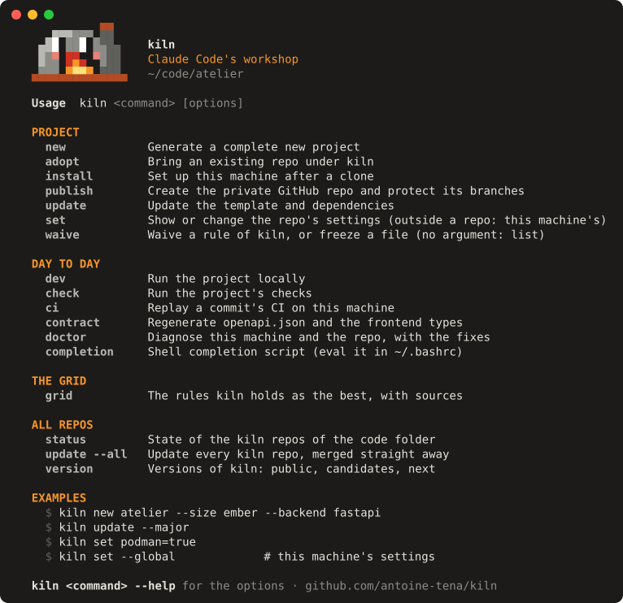
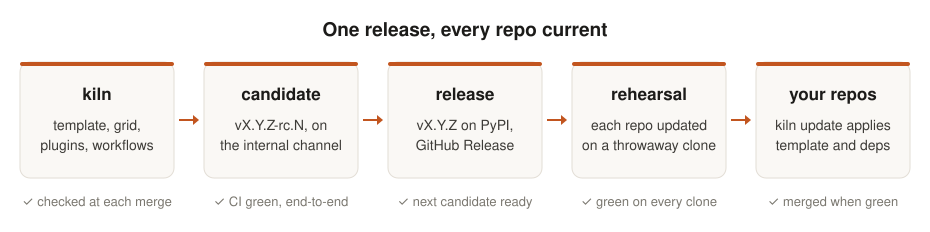
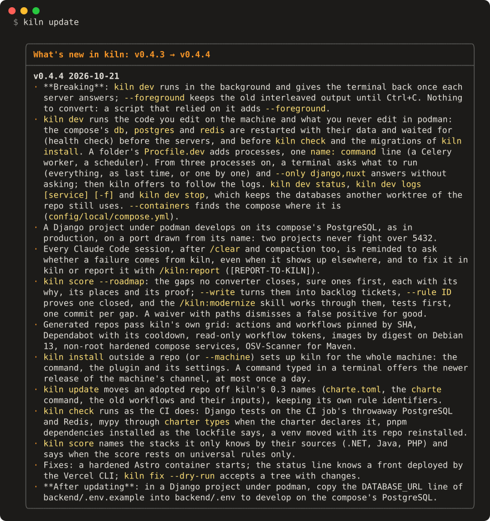
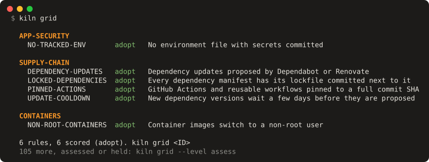

<div align="center">

# kiln

**A repo Claude Code can work in safely, in three questions — then kept at the best way to work, release after release.**

[](https://pypi.org/project/kiln-cli/)
[](https://github.com/antoine-tena/kiln/actions/workflows/kiln.yml)
[](https://www.python.org/)
[](LICENSE)

[**Reference**](docs/reference.md) · [Changelog](CHANGELOG.md) · [Contributing](CONTRIBUTING.md) · [Français](README.fr.md)



<i><code>kiln</code> on its own: every command, grouped by what you are doing.</i>

</div>

Claude Code writes code fast. A repo needs more than that to stay healthy: a current stack, rules
an agent cannot argue its way around, a git workflow that survives a bad afternoon, and someone
to stop it going stale on day ninety. kiln does all four, for every repo you own.

## Highlights

- 🧱 **Three questions, a complete repo.** What you build, how big, which language: kiln picks
  the stack and writes the code, tests, linters, CI, pre-commit hooks, containers and the
  instructions Claude reads first.
- 🔄 **Current for as long as it lives.** `kiln update` replays the template, takes compatible
  dependency upgrades, converts what a release renamed and runs the checks before you commit.
- 🧪 **Tried before it touches anything.** `kiln update --rehearse` plays the update on a
  throwaway clone and reports; `--all` does it for every repo in your code folder.
- 📏 **Rules that hold.** `charter` checks each file Claude edits in about 0.15 s (banned tools,
  names, sizes, personal data in logs); ratchets and coverage floors hold at each commit and in
  CI. A waiver is dated and justified.
- 🧭 **The best, with its sources.** `kiln grid` lists the practices kiln stands behind, each
  with its reason, its sources checked and dated, and how it is detected.
- 🤖 **Built for Claude Code.** Skills for worktrees, merges, releases and reviews; hooks that
  guard your branches; a status line that shows CI, tickets and production.
- 💸 **No GitHub minutes for private repos.** Their CI runs on your machine (`kiln ci`, verdict
  kept as a git note); public repos run on GitHub, where it is free.

## Install

```sh
uv tool install kiln-cli     # the command is kiln; uv fetches Python 3.14 if needed
```

Or try it without installing: `uvx kiln-cli new my-app`. macOS, Linux and Windows through WSL;
[pnpm](https://pnpm.io/) for JavaScript fronts, [podman](https://podman.io/) for containers.

## Quick start

```console
$ kiln new my-app            # three questions, then a private GitHub repo (--no-github: local)
$ cd my-app && kiln dev      # the stack's dev servers, output prefixed by service
$ kiln check                 # ruff, mypy, pytest, ESLint, type checks, then charter
$ claude                     # Claude Code, with kiln's rules, skills and hooks loaded
```

## What you get

| You build | Backend | Frontend |
|---|---|---|
| A full app (`app`) | Django + Django Ninja | Nuxt + Vue |
| An API (`api`) | FastAPI | — |
| A content site (`site`) | — | Astro |
| A data dashboard (`dashboard`) | polars, marimo, Plotly | Streamlit |
| A data analysis (`analysis`) | polars, marimo, Plotly | — |
| A command-line tool (`cli`) | Python, installable | — |

Next.js, Dash and Java 25 + Maven are there too, and every combination is generated and checked
by kiln's tests. **Django and Nuxt are complete; the other stacks are frozen but maintained**:
new grid rules go to Django and Nuxt first.

Every repo also gets uv, pnpm and podman (never pip, npm or docker), CI calling kiln's reusable
workflows, protected `main` and `develop` branches, a `docs/backlog/` of typed tickets, and a
size — `spark`, `ember`, `flame` or `blaze` — that decides how much ceremony it carries. A
Django app can ship to a hardened VPS (Caddy, read-only containers, automatic rollback, tested
backups), a Nuxt front to Vercel.

## Kept current

<p align="center">
  <picture>
    <source media="(prefers-color-scheme: dark)" srcset="docs/assets/kiln-flow-dark.svg">
    
  </picture>
</p>

A kiln release first ships as a candidate (`-rc.N`), tagged only once its CI is green on Linux
and macOS — including an update from every release since v0.3.0, through an installed tool. It
is promoted when the next candidate is ready, then rehearsed on a clone of each repo before
`kiln update --all` merges it, one worktree per repo. Repos quote kiln's workflows at the exact
release they follow, so nothing reaches them between releases.

<p align="center">
  
</p>
<p align="center"><i>What <code>kiln update</code> shows as it crosses a release, read from kiln's changelog.</i></p>

## The grid

<p align="center">
  
</p>
<p align="center"><i><code>kiln grid</code>: the rules kiln stands behind today; <code>kiln grid &lt;ID&gt;</code> shows one with its sources.</i></p>

One small TOML file per rule, on two axes: its theme (supply chain, containers, tests…) and its
scope (universal, a language, a framework, a tool). Each says why, cites sources weighed in a
fixed order — official docs, security advisories, measured studies, adoption data, blogs — and
carries a level from Thoughtworks' Technology Radar: adopt, trial, assess, hold. Only adopted
rules count; 105 drafts drawn from a production repo wait behind `kiln grid --level assess`.
Each scored rule ships with a repo that passes it and one that fails it.

## Compared with Copier and cookiecutter

kiln is [Copier](https://copier.readthedocs.io) underneath: every project keeps its
`.copier-answers.yml`, and plain Copier still works on it. kiln adds what comes after day one.

| | cookiecutter | Copier | **kiln** |
|---|:---:|:---:|:---:|
| Generate a project | ✅ | ✅ | ✅ |
| Apply template updates to existing projects | ❌ | ✅ | ✅ |
| Pick the stack from what you build | ❌ | ❌ | ✅ |
| Change the stack later (`kiln set frontend=nuxt`) | ❌ | partial | ✅ |
| Upgrade dependencies and run the checks in the same step | ❌ | ❌ | ✅ |
| Rehearse, then update every repo at once | ❌ | ❌ | ✅ |
| Shared CI workflows, quoted at a release | ❌ | ❌ | ✅ |
| A rule engine with dated waivers (`charter`) | ❌ | ❌ | ✅ |
| Claude Code skills, hooks and instructions | ❌ | ❌ | ✅ |

kiln is opinionated on purpose. For a neutral templating engine, use Copier; for a workflow that
stays maintained, use kiln, or fork it and make the opinions yours.

## Reference

Every command and option, every `kiln set` key, the reusable workflows and the Claude Code
plugins: [**docs/reference.md**](docs/reference.md). In a terminal, `kiln <command> --help`.

## Status

kiln runs a handful of real repos every day, one of them in production. It numbers releases
like Claude Code: in `0.x`, each release bumps the patch, breaking changes first in the
[changelog](CHANGELOG.md) and converted by `kiln update`; the minor marks a milestone. Strict
semver starts at 1.0.

## Contributing

Issues and pull requests are welcome: see [CONTRIBUTING.md](CONTRIBUTING.md), and the
[`good first issue`](https://github.com/antoine-tena/kiln/labels/good%20first%20issue) label to
start. In a kiln repo, `/kiln:report` turns a kiln defect into a ready-to-post issue or pull
request, posted only once you approve. If kiln saves you time, a ⭐ helps others find it.

## License

[MIT](LICENSE)
